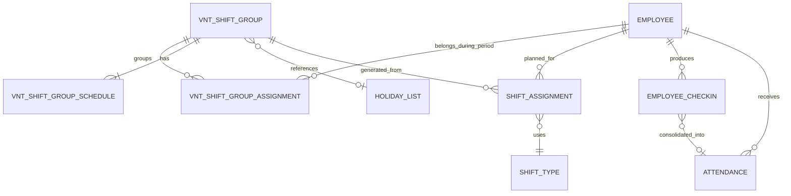
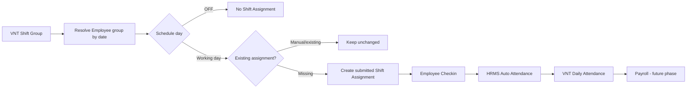

# Quản lý ca/kíp và chấm công nhà máy

Tài liệu này là source of truth cho phase 1 của chức năng ca/kíp trên ERPNext/Frappe HR v15. Phạm vi hiện tại là Kíp, Holiday List, Shift Assignment, tích hợp Employee Checkin/Attendance và Bảng công ngày. Payroll và Manufacturing chỉ được mô tả như hướng tích hợp tương lai.

## Nguyên tắc bất biến

- Không update, delete, rename hoặc migrate tự động Employee, Default Shift, Shift Type, Holiday List hay Employee Checkin hiện hữu. Workflow chuyển Kíp có ngày hiệu lực là ngoại lệ có kiểm soát: chỉ xử lý Attendance/Shift Assignment do pipeline tạo khi preview chứng minh an toàn; không bao giờ xóa hoặc sửa `time`/`log_type` của Checkin.
- Không sửa source của `frappe`, `erpnext` hoặc `hrms`; mọi code nằm trong app `vinatex`.
- Migration chỉ tạo schema/metadata. Master Kíp và Holiday List chỉ được tạo bởi thao tác chủ động của HR/System Manager.
- Bản ghi đã tồn tại nhưng khác cấu hình mong đợi chỉ được báo diff; không overwrite.
- `Shift Assignment` là planned shift, `Employee Checkin` là log thô, `Attendance` là kết quả công cuối.

## BƯỚC 1 - Chuẩn hóa Employee

Trước triển khai cần xuất danh sách Employee và kiểm tra tối thiểu: mã nhân viên, `attendance_device_id`, Company, Department, Designation, trạng thái, ngày vào/nghỉ việc, Holiday List và Default Shift. `attendance_device_id` phải duy nhất trong phạm vi mà tích hợp máy chấm công đang dùng; nếu thiết bị dùng thêm Branch thì khóa đối chiếu là device ID + Branch.

Không sửa Employee cũ bằng patch. Các dòng thiếu Company, Department hoặc device ID được đưa vào danh sách ngoại lệ để HR xử lý thủ công. Hai field mới `custom_working_schedule_type` và `custom_shift_group` chỉ tạo schema, không tự populate. Trước go-live cần đối chiếu tổng số Employee Active theo Company/Department, số người dùng Default Shift legacy và số người đã có lịch sử VNT Shift Group Assignment.

## BƯỚC 2 - Xác định 4 Shift Type

Các khung giờ nghiệp vụ:

| Loại ca | Bắt đầu | Kết thúc |
|---|---:|---:|
| Sáng | 06:00 | 14:00 |
| Chiều | 14:00 | 22:00 |
| Đêm | 22:00 | 06:00 ngày sau |
| Hành chính | 07:30 | 16:30 |

Setup chỉ reuse Shift Type có thời gian khớp. Nếu đúng tên nhưng sai giờ, setup báo `CONFLICT` và không sửa. Nếu tên khác nhưng thời gian đúng, admin truyền mapping tên thực tế. Shift Type trả lời “làm từ mấy giờ đến mấy giờ”; Kíp trả lời “thuộc nhóm luân phiên nào”, vì vậy Kíp không phải Shift Type trong kiến trúc mới.

Ca `Hành chính` áp dụng từ 07:30–16:30 kể từ 01/10/2026. Khi đổi khung giờ phải refresh dữ liệu chấm công từ ngày hiệu lực; không sửa log Checkin thô.

## BƯỚC 3 - Xác định chính sách hành chính linh hoạt

Không giả định mọi nhân sự văn phòng, nhà ăn, vào bông hoặc đóng gói cùng một giờ. Business cần xác nhận theo Department/Designation: giờ chuẩn, thời gian nghỉ, grace period, yêu cầu chấm vào/ra, xử lý thứ Bảy/Chủ nhật, ca gãy và làm thêm. Khi chưa có xác nhận, nhân viên hành chính tiếp tục dùng Default Shift chuẩn của ERPNext và không được generator Kíp xử lý.

## BƯỚC 4 - Xây dựng 7 Holiday List

Ngày nghỉ chu kỳ:

| Kíp | Ngày nghỉ tuần |
|---|---|
| Kíp 1 | Friday |
| Kíp 2 | Thursday |
| Kíp 3 | Wednesday |
| Kíp 4 | Tuesday |
| Kíp 5 | Monday |
| Kíp 6 | Sunday |
| Kíp 7 | Saturday |

Holiday List chỉ mô tả ngày không phải làm, không xác định Sáng/Chiều/Đêm. Action `Sync Holiday List` tạo một list mới theo năm khi chưa tồn tại. Nếu list/tên đã tồn tại, action so sánh ngày, trả diff và không overwrite. Không tự gắn list vào Employee, Company hay Shift Type.

## BƯỚC 5 - Xây dựng VNT Shift Group

`VNT Shift Group` (nhãn Kíp làm việc) có tên Kíp, Company, Holiday List, hiệu lực, disabled, mô tả và bảng `schedule`. Mỗi dòng child `VNT Shift Group Schedule` gồm weekday, Shift Type, `is_off`, sequence và note.

Validation bảo đảm mỗi weekday chỉ xuất hiện một lần; weekday thuộc Monday–Sunday; OFF không có Shift Type; ngày làm phải có Shift Type tồn tại. Controller không thay đổi Shift Type. Quan hệ nghiệp vụ là `Kíp -> weekly schedule -> Holiday List`.

## BƯỚC 6 - Khởi tạo 7 Kíp

Ma trận chuẩn:

| Kíp | Monday | Tuesday | Wednesday | Thursday | Friday | Saturday | Sunday |
|---|---|---|---|---|---|---|---|
| Kíp 1 | Chiều | Chiều | Đêm | Đêm | OFF | Sáng | Sáng |
| Kíp 2 | Chiều | Đêm | Đêm | OFF | Sáng | Sáng | Chiều |
| Kíp 3 | Đêm | Đêm | OFF | Sáng | Sáng | Chiều | Chiều |
| Kíp 4 | Đêm | OFF | Sáng | Sáng | Chiều | Chiều | Đêm |
| Kíp 5 | OFF | Sáng | Sáng | Chiều | Chiều | Đêm | Đêm |
| Kíp 6 | Sáng | Sáng | Chiều | Chiều | Đêm | Đêm | OFF |
| Kíp 7 | Sáng | Chiều | Chiều | Đêm | Đêm | OFF | Sáng |

`setup_default_shift_groups` là action idempotent và chủ động. Nó chỉ insert master còn thiếu; nếu master đã có, chỉ so sánh và trả warning, không update schedule hay hiệu lực.

## BƯỚC 7 - Mapping Employee vào Kíp

Nguồn xác định Kíp cho ngày D:

1. `VNT Shift Group Assignment` Active bao phủ D.
2. Legacy read-only fallback chỉ dành cho dữ liệu chưa được chuẩn hóa: `Employee.custom_shift_group` hoặc `Employee.default_shift` trùng tên một `VNT Shift Group` đang có hiệu lực.

Assignment là source of truth theo ngày. `Employee.custom_shift_group` chỉ là cache “Kíp hiện tại” tại ngày server: workflow và scheduler đồng bộ cache từ đúng một membership đang hiệu lực; chuyển Kíp tương lai không đổi cache trước ngày hiệu lực. Không được Save trực tiếp field này để chuyển Kíp. Nhân viên có Default Shift `Hành chính` hoặc Shift Type thường không trùng master Kíp sẽ không được engine xử lý.

## BƯỚC 8 - Các lịch đặc biệt

Lịch đặc biệt nhưng lặp ổn định theo tuần được khai báo thành một `VNT Shift Group` riêng, dùng lại các Shift Type hiện có và được gán bằng `VNT Shift Group Assignment` có hiệu lực theo thời gian. Tên Kíp nên mô tả mẫu lịch/ngày nghỉ thay vì tên cá nhân để có thể tái sử dụng.

Manual Shift Assignment chỉ dùng cho ngoại lệ theo ngày hoặc khoảng ngày cụ thể. Một lần đổi ca, đi làm thay hoặc điều động không làm thay đổi Kíp gốc. Phase đầu không tạo DSL chu kỳ hoặc mô hình ca gãy.

## BƯỚC 9 - Sinh Shift Assignment

Generator tải Employee, lịch sử Kíp, weekly schedule và Shift Assignment hiện hữu theo batch. Với mỗi Employee/ngày:

- Có assignment chưa bị cancel bao phủ ngày: không tạo thêm, kể cả assignment đã chuyển sang `Inactive` vì hết hạn; assignment không mang marker của engine được coi là manual và được bảo vệ.
- Schedule là OFF: không tạo Shift Assignment.
- Ngày làm và chưa có assignment: tạo một Shift Assignment submitted với `start_date = end_date = ngày`, source `Kíp tự động`, Kíp và schedule date.
- Không tìm thấy Kíp/Shift Type hợp lệ: trả lỗi theo dòng, log tổng hợp và tiếp tục Employee khác.

Generator không update/delete assignment hiện hữu và không commit từng Employee. Chạy lại cho cùng khoảng ngày cho kết quả idempotent.

## BƯỚC 10 - Đối chiếu với lịch Excel

UAT xuất preview ERPNext cho ít nhất một chu kỳ đầy đủ, khóa cùng danh sách Employee và khoảng ngày như Excel, rồi so Employee + Date + Kíp + Shift/OFF. Sai lệch được phân loại: mapping Kíp, weekday schedule, manual override, ngày ngoài hiệu lực hoặc dữ liệu Excel. Chỉ generate sau khi HR ký xác nhận mẫu đối chiếu.

## BƯỚC 11 - Kết nối máy chấm công

Giữ tích hợp máy chấm công hiện tại tạo `Employee Checkin`. Không tạo bảng log khác và không sửa lịch sử Checkin. Sau khi Shift Assignment có trước thời điểm quẹt thẻ, controller HRMS tự gắn `shift`, `shift_start`, `shift_end` và cửa sổ actual theo Shift Type.

## BƯỚC 12 - Chạy Employee Checkin trước Payroll

Kiểm thử lần lượt: mapping device ID, timezone site, log trùng, log_type, ca ngày, ca đêm qua 00:00 và log ngoài cửa sổ. Chỉ khi Checkin đã vào đủ, gắn đúng shift và không còn backlog mới chạy Auto Attendance. Không dùng Payroll để phát hiện lỗi tích hợp Checkin.

## BƯỚC 13 - So sánh Attendance

Đối chiếu ít nhất một chu kỳ 7 ngày và khuyến nghị song song 2–4 tuần: planned Shift Assignment, actual Checkin, Attendance status, working hours, late/early và leave. Ca đêm phải có Attendance Date là ngày bắt đầu ca. Chỉ sau khi tỷ lệ sai lệch đạt ngưỡng business chấp nhận mới nối sang Payroll chính thức.

## BƯỚC 14 - Nghỉ phép / đổi ca / thay ca

- Nghỉ phép: Leave Application/Attendance chuẩn, không đổi Kíp.
- Đổi ca một ngày: manual Shift Assignment, source `Đổi ca`.
- Điều động/làm thay: manual Shift Assignment, source `Điều động` hoặc `Phân ca thủ công`.
- Đổi Kíp dài hạn: đóng hiệu lực assignment cũ và tạo `VNT Shift Group Assignment` mới, không sửa lịch sử cũ.

### Phân / chuyển Kíp có ngày hiệu lực

Employee Form và Employee List dùng chung một dialog và cùng facade server. Với một nhân sự, HR đổi **Kíp hiện tại** trên hồ sơ; giao diện hoàn tác field ngay rồi mở dialog để HR chọn ngày hiệu lực. Nếu hồ sơ còn thay đổi khác chưa lưu, dialog không mở và các thay đổi đó được giữ nguyên. Với nhiều nhân sự, HR lọc/tick các dòng trên Employee List rồi chọn **Actions → Phân / chuyển kíp hàng loạt**. Không Save trực tiếp field Kíp để bỏ qua workflow.

Dialog yêu cầu Kíp mới, ngày hiệu lực, ngày kết thúc thuộc Kíp, ngày sinh ca kế hoạch đến và lý do. Nút **Xem trước** chỉ đọc dữ liệu, hiển thị Kíp theo membership, Kíp đang hiển thị, mismatch cần sửa, ca/Attendance sẽ xử lý, punch được giữ và blocker của từng nhân sự. Một blocker làm toàn batch không thể execute.

Với **ngày hiệu lực là hôm nay hoặc tương lai**, HR User/HR Manager/System Manager có thể thao tác, tối đa 200 Employee và 366 ngày. Batch nhỏ chạy đồng bộ; batch trên 500 employee-days vào long queue. Chuyển tương lai tạo membership/kế hoạch ngay nhưng `Kíp hiện tại` vẫn là Kíp nguồn đến ngày hiệu lực; kết quả giao diện phải ghi rõ “đã lên lịch”.

Nếu ngày hiệu lực là **hôm nay** và nhân sự đã có Checkin hôm nay (chưa có Attendance hôm nay), transfer không bị chặn: ca tự động của hôm nay được cancel ở mức DB kèm Comment audit (không qua `Shift Assignment.cancel()` vì HRMS chặn khi có Checkin cùng Shift Type), generator sinh ca đích cho hôm nay, rồi punch hôm nay được trỏ lại theo ca đích bằng `sync_checkin_shift_fields_for_date`. Attendance hôm nay, Checkin của ngày sau hôm nay, hoặc ca tự động trải nhiều ngày có Checkin hôm nay vẫn là blocker.

Với **ngày hiệu lực trong quá khứ**, dialog tự chuyển sang nhánh hồi tố có kiểm soát:

- Chỉ HR Manager/System Manager được preview và execute; tối đa 20 Employee, 366 ngày, chạy đồng bộ và all-or-nothing. `membership_end_date` phải từ hôm nay trở đi.
- Preview hiển thị Attendance/ca kế hoạch sẽ xử lý, punch qua ranh giới được giữ, membership action và blocker theo từng Employee. Preview sinh `preview_token`; execute khóa Employee, nạp lại snapshot và từ chối token stale trước lần ghi đầu tiên.
- Nút execute chỉ xuất hiện khi toàn batch `READY`. Người thao tác phải nhập đúng `XÁC NHẬN HỒI TỐ`.
- Blocker gồm membership/assignment chồng lấn, ca manual/legacy, leave/Attendance Request, Attendance legacy không chứng minh được nguồn, dòng giải trình đã có quyết định HR và Salary Slip đã submit. Attendance thuộc work date hôm nay luôn block. Checkin hôm nay **không** block: punch thuộc work date hôm nay được giữ nguyên làm log thô (liệt kê trong `preserved_checkins`), còn punch đuôi ca Đêm của hôm qua được dùng khi rebuild hôm qua.

Khi thực hiện hồi tố, service khóa các Employee theo thứ tự ổn định và chạy toàn bộ batch trong một transaction:

1. Attendance đủ điều kiện trong các work date đã hoàn tất được cancel bằng Document API; Checkin thô không bị xóa hay sửa `time`/`log_type`. Punch đã link Attendance trước ngày hiệu lực được giữ nguyên.
2. Chỉ Shift Assignment mang đủ marker `custom_generated_by_shift_group = 1` và source `Kíp tự động` được rewrite/cancel. Ca manual/legacy luôn là blocker. Mỗi thay đổi lịch sử có Comment chứa operation id và before snapshot.
3. Membership Kíp cũ kết thúc tại ngày liền trước; membership Kíp mới được tạo cùng audit note. `Employee.default_shift` không đổi; cache `custom_shift_group`/`custom_working_schedule_type` được resolve lại từ membership có hiệu lực ở ngày hiện tại.
4. Ca tự động của **hôm nay** được rewrite tại chỗ sang Kíp/Shift đích (`REWRITE_CURRENT_AUTO`), hoặc cancel ở mức DB nếu ngày đích OFF (`CANCEL_CURRENT_AUTO`), kèm Comment audit. Không dùng `Shift Assignment.cancel()` cho hôm nay vì HRMS chặn cancel khi đã có Checkin cùng Shift Type trong ngày. Ca từ ngày mai trở đi vẫn cancel bằng Document API rồi sinh lại.
5. Generator sinh lại ca; pipeline chỉ tính Attendance từ ngày hiệu lực đến hôm qua. Đuôi ca Đêm kết thúc sáng nay có thể thuộc work date hôm qua. Không tạo/cancel/chốt Attendance cho work date hôm nay; Attendance hôm nay do job hằng ngày tạo sau đó theo ca mới.
6. Punch chưa link Attendance của hôm nay được trỏ lại `shift`/`shift_start`/`shift_end`/`shift_actual_*` theo ca đích bằng `sync_checkin_shift_fields_for_date` (cùng quy tắc ownership của pipeline), để báo cáo trong ngày không còn hiển thị ca cũ.
7. Phiếu `VNT Attendance Confirm` được refresh theo từng tháng. Một lỗi ở bất kỳ Employee nào rollback toàn batch; chạy lại trạng thái đích trả `ALREADY_APPLIED`.

## BƯỚC 15 - Payroll

Phase này không sửa Salary Slip, Payroll Entry hoặc Salary Structure. Điều kiện trước kết nối Payroll: mapping Kíp ổn định, Checkin đầy đủ, Attendance đã được HR xác nhận, chính sách lễ/OT/phụ cấp ca đêm và rounding có văn bản, cùng kế hoạch reconciliation/rollback.

## BƯỚC 16 - Manufacturing integration

Tương lai có thể dùng ca thực tế để kiểm tra nhân sự tại Workstation, phân bổ người vào Work Order/Job Card và đối soát năng suất theo ca. Không sửa Workstation, Work Order hoặc Job Card trong phase này.

## BƯỚC 17 - Default Shift

Default Shift vẫn phù hợp cho nhân viên Hành chính hoặc ca cố định. Kiến trúc mới không dùng Default Shift làm nguồn Kíp. Các giá trị legacy `Kíp X` chỉ được đọc khi có master `VNT Shift Group` cùng tên; không migrate hoặc clear Employee.

## BƯỚC 18 - Không tạo Shift Type Nghỉ

OFF là thiếu nghĩa vụ làm việc trong schedule và không sinh Shift Assignment. Tạo Shift Type `Nghỉ` sẽ làm sai semantics của HRMS, có thể khiến Checkin/Attendance coi ngày nghỉ là một ca làm.

## BƯỚC 19 - Holiday List precedence

Không gắn Holiday List Kíp vào `Sáng`, `Chiều`, `Đêm`, vì một Shift Type được dùng bởi cả bảy Kíp với ngày nghỉ khác nhau. VNT Shift Group giữ link Holiday List phục vụ nghiệp vụ/report. ERPNext v15 hiện tại không có Holiday List Assignment; không tự thay `Employee.holiday_list`, do đó Auto Attendance cần chính sách holiday được xác nhận trước go-live.

## BƯỚC 20 - Ngày lễ

Ngày nghỉ Kíp là chu kỳ sản xuất; ngày lễ pháp định là calendar pháp lý. Nhà máy có thể vẫn chạy ngày lễ. Sync phase đầu chỉ tạo weekly OFF, không merge lễ pháp định và không thêm logic lương ngày lễ.

## BƯỚC 21 - Employee Checkin

Employee Checkin là raw event từ thiết bị. Không dùng Checkin làm lịch tương lai hoặc kết quả công. Báo cáo ưu tiên `shift_start.date()` để quy log ca đêm về ngày bắt đầu ca; chỉ fallback theo cửa sổ Shift Type khi log chưa có shift metadata. Không update/delete log để “sửa” báo cáo.

## BƯỚC 22 - Attendance

Attendance là kết quả cuối theo Employee + attendance_date + shift. Job VNT resolve lại ca kế hoạch, nhóm Employee Checkin theo cửa sổ Shift Type (kể cả ca qua đêm) và tạo/bổ sung Attendance mà không yêu cầu `Enable Auto Attendance`.

Riêng báo cáo `Tổng hợp chấm công tháng`, `Tr`/`Sm` được đối chiếu trực tiếp với `Start Time`/`End Time` và grace period của Shift Type. Phép tính này không phụ thuộc `Enable Auto Attendance` hay hai cờ marking. Job tạo Attendance vẫn tôn trọng các cờ marking, do đó thay đổi hiển thị báo cáo không tự ý ghi lại `late_entry`/`early_exit` trên Attendance đã chốt.

## BƯỚC 23 - Lịch sử đổi Kíp

`VNT Shift Group Assignment` lưu Employee, Company, Kíp, từ/đến ngày, status và note, đồng thời là nguồn xác định Kíp theo ngày. Hai assignment Active của cùng Employee không được overlap. Company của Employee và Kíp phải trùng. `Employee.custom_shift_group` chỉ là cache của membership đang hiệu lực hôm nay. Luồng thường không sửa lịch sử; luồng hồi tố chỉ được sửa dữ liệu pipeline khi preview chứng minh an toàn. Mỗi batch hồi tố có operation id, Comment trên Employee/Shift Assignment, membership note và before snapshot. Attendance bị cancel vẫn được giữ làm audit; Employee Checkin thô và punch thuộc ngày công trước ranh giới không bị viết lại.

## BƯỚC 24 - Bảng công ngày

Script Report `VNT Daily Attendance` hỗ trợ From/To Date, Company, Department, Employee, Shift Group, Shift Type và Attendance Status. Mỗi dòng thể hiện planned shift/source, actual in/out, working hours, Attendance status, late/early, leave, OFF/holiday và note. `Attendance Status` là kết quả của Attendance đã submit; có Checkin không đồng nghĩa đã có Attendance. Attendance chưa submit hiển thị `Draft Attendance`, dòng chưa có Attendance hiển thị `Not Created` (`Chưa tạo Attendance`), còn ngày OFF không cần công hiển thị `Not Required (Shift OFF)`. OFF không tự hiển thị Absent. Giờ vào/ra lấy từ Attendance khi có, nếu thiếu thì dùng Checkin đầu/cuối và được trả về đúng kiểu Time để tránh giao diện định dạng sai giờ.

## BƯỚC 25 - Đổi ca / manual override

Assignment đã có luôn thắng schedule. Các source khác `Kíp tự động` hoặc record không có marker engine là manual/legacy và không được generator update/delete. Khi quản đốc đổi CA_SANG thành CA_DEM, scheduler sau đó chỉ trả `SKIP_MANUAL`/`SKIP_EXISTING`.

## BƯỚC 26 - Scheduler 60 ngày

Daily scheduler gọi service cho `[today, today + 60 days]`. Giá trị 60 chỉ khai báo một lần trong constants. Job không tạo master, không sửa Employee/Holiday List/Shift Type và tiếp tục xử lý Employee khác khi một dòng lỗi. Kết quả gồm số CREATE, SKIP_EXISTING, SKIP_MANUAL, OFF và ERROR.

## BƯỚC 27 - Roster / vận hành hằng ngày

Shift Assignment chuẩn tự xuất hiện trong Roster/Calendar HRMS. HR/Quản đốc dùng preview trước generate, xem tuần/tháng theo Shift Type và dùng manual Shift Assignment cho ngoại lệ. Cuối ngày đối chiếu Bảng công ngày; cuối tuần rà lỗi mapping và log offshift.

## BƯỚC 28 - Kiến trúc cuối cùng

Luồng mục tiêu:

`VNT Shift Group -> Employee mapping -> Shift Assignment -> Employee Checkin -> Attendance -> Bảng công -> Payroll (phase sau)`.

VNT Shift Group là nguồn master Kíp; VNT Shift Group Assignment là lịch sử thành viên; Shift Assignment là lịch ngày cụ thể. Các object chuẩn HRMS tiếp tục phụ trách nhận dạng cửa sổ ca và Auto Attendance.

## Kiến trúc tổng thể

| Loại dữ liệu | Source of truth |
|---|---|
| Kíp và lịch tuần | VNT Shift Group + Schedule |
| Lịch sử thuộc Kíp | VNT Shift Group Assignment |
| Ca kế hoạch theo ngày | Shift Assignment |
| Log máy | Employee Checkin |
| Công cuối | Attendance |
| Ngày nghỉ | Holiday List |
| Ca cố định/hành chính | Employee.default_shift khi phù hợp |

## ER diagram



## Flow diagram



## Data dictionary

### VNT Shift Group

| Field | Type | Ý nghĩa |
|---|---|---|
| shift_group_name | Data | Tên duy nhất, ví dụ Kíp 1 |
| company | Link Company | Công ty áp dụng |
| holiday_list | Link Holiday List | List weekly OFF được xác nhận |
| effective_from/effective_to | Date | Hiệu lực master |
| disabled | Check | Ngừng dùng cho ngày mới |
| description | Small Text | Ghi chú |
| schedule | Table | Bảy dòng weekday |

### VNT Shift Group Schedule

| Field | Type | Ý nghĩa |
|---|---|---|
| day_of_week | Select | Monday–Sunday |
| shift_type | Link Shift Type | Ca của ngày làm |
| is_off | Check | Ngày nghỉ Kíp |
| sequence | Int | Thứ tự 1–7 |
| note | Small Text | Ghi chú |

### VNT Shift Group Assignment

| Field | Type | Ý nghĩa |
|---|---|---|
| employee/employee_name | Link/Data | Nhân viên |
| company | Link Company | Company snapshot/validation |
| shift_group | Link VNT Shift Group | Kíp |
| from_date/to_date | Date | Khoảng hiệu lực đóng/mở |
| status | Select | Active/Inactive |
| note | Small Text | Lý do/chứng từ |

## Danh sách DocType mới

1. VNT Shift Group.
2. VNT Shift Group Schedule (child).
3. VNT Shift Group Assignment.

## Danh sách custom fields

- Employee: `custom_working_schedule_type`, `custom_shift_group`.
- Shift Assignment: `custom_assignment_source`, `custom_shift_group`, `custom_generated_by_shift_group`, `custom_schedule_date`.

Không field nào được backfill trong migration.

## Danh sách file code đã tạo

- JSON/controller cho ba DocType trong `vinatex/vnt_hr/doctype`; UI action và bộ test đặt cùng `VNT Shift Group`.
- Package `vinatex/vnt_hr/shift_management` cho constants, resolver/generator, Holiday List, setup và scheduler.
- `shift_group_transfer_service.py` và `employee_list.js` cho preview/thực hiện phân-chuyển Kíp hàng loạt từ Employee List.
- Script Report `vinatex/vnt_hr/report/vnt_daily_attendance`.
- Customization `vinatex/vnt_hr/custom/shift_assignment.json`.

## Danh sách file code đã sửa

- `vinatex/hooks.py`: đăng ký daily scheduler.
- `vinatex/vnt_hr/custom/employee.json`: thêm hai field không có default.
- `vinatex/doctype/overrides/holiday_list.py`: loại bỏ side effect mass-assign Employee/Company khi insert Holiday List.
- `vinatex/doctype/overrides/attendance.py`: gọi pipeline chấm công theo Shift Assignment/Kíp thay cho logic Hành chính hard-code.
- `vinatex/vnt_hr/attendance_processing.py`: dùng chung việc resolve ca, cửa sổ Checkin, ca đêm, ngày nghỉ và tạo/link Attendance.
- `Tổng hợp chấm công tháng`: ma trận tháng dùng các ký hiệu `Tr`, `Sm`, `X`, `+`, `KR`, `KV`, `V`, `Đ`, `Off`.
- `vinatex/doctype/overrides/timekeeping.py`: không tái phân loại/sửa `log_type` của Checkin đã tồn tại.

## Scheduler

Entry daily gọi `run_daily_shift_assignment_generation`. Scheduler chỉ generate assignment, không setup master và không sync Holiday List. Không gọi `frappe.db.commit()` trong service.

Job `monitor_create_attendance` chạy 10:45, sau lượt đồng bộ máy 10:30; job tạo phiếu giải trình chạy 11:00. Thứ tự này bảo đảm log ra của ca Đêm 22:00–06:00 đã được đồng bộ trước khi tính công.

## Pipeline Attendance

1. Tạo bù Shift Assignment còn thiếu trong kỳ xử lý; bản ghi manual/legacy luôn được ưu tiên và không bị ghi đè.
2. Resolve ca theo thứ tự Shift Assignment → VNT Shift Group Assignment/custom Shift Group/legacy Kíp → Employee Default Shift cho nhân sự ngoài Kíp.
3. Gom Checkin theo cửa sổ Shift Type (`begin_check_in_before...`/`allow_check_out_after...`), không gom theo ngày dương lịch. Ca Đêm giữ Attendance Date là ngày bắt đầu ca.
4. Đồng bộ metadata ca cho Checkin chưa link Attendance; Checkin thô và timestamp không bị sửa/xóa.
5. Tạo Attendance theo cấu hình ngưỡng/late/early của Shift Type; ngày làm không có log tạo Absent; nhân sự `custom_need_check=1` tạo Present.
6. Attendance đã có không bị tạo trùng. Bản ghi legacy thiếu giờ chỉ được bổ sung các field còn trống và link các Checkin chưa link.

API hỗ trợ `dry_run=1` và khoảng ngày tường minh để kiểm tra/backfill có kiểm soát.

Ví dụ kiểm tra trước khi backfill (không ghi dữ liệu):

```bash
bench --site <site> execute vinatex.vinatex.doctype.overrides.attendance.create_attendance_from_checkin \
  --kwargs '{"from_date":"2026-10-01","to_date":"2026-10-06","dry_run":1}'
```

Chỉ HR Manager/System Manager được chạy ghi thật; HR User được chạy `dry_run`.

## Manual generation

Form VNT Shift Group có Preview, Generate và Sync Holiday List. Employee List có action Phân / chuyển Kíp hàng loạt cho các dòng đang chọn. API chuyển hôm nay/tương lai cho phép HR User, HR Manager hoặc System Manager; API hồi tố chỉ cho HR Manager/System Manager. Các API setup/generate master vẫn giữ quyền quản trị hiện có. Tất cả API giới hạn ngày hợp lệ và không `allow_guest`. Preview không ghi dữ liệu; execute hồi tố cần token còn hiệu lực và phrase xác nhận chính xác.

Khởi tạo master lần đầu là thao tác riêng, ví dụ trên staging:

```bash
bench --site <site> execute vinatex.vnt_hr.shift_management.setup.setup_default_shift_groups \
  --kwargs '{"company":"<company>","effective_from":"2026-10-06"}'
```

Lệnh mặc định không tạo/sửa Shift Type. Chỉ truyền `create_missing_shift_types: true` sau khi HR đã duyệt kết quả `inspect_shift_type_mapping`; một Shift Type cùng tên nhưng sai giờ vẫn luôn là conflict và không bị sửa.

## Legacy compatibility

Fallback chỉ hợp lệ khi `Employee.default_shift` trùng chính xác tên master Kíp. Do đó `Kíp 2` được hiểu là group sau khi master `Kíp 2` tồn tại, còn `Hành chính`, `Đi ca`, `Vệ sinh` tiếp tục là Shift Type chuẩn. Không có lệnh save/update Employee trong resolver.

## Quy tắc bảo toàn dữ liệu cũ

- Không có data patch cho Employee/Checkin/Attendance/Shift Assignment/Holiday List.
- Generator insert dữ liệu mới và skip mọi assignment có trước.
- Holiday sync chỉ insert list mới hoặc trả diff; không clear/append vào list tồn tại.
- Setup chỉ insert master còn thiếu; không sửa schedule hiện hữu.
- Attendance job không sửa timestamp/log_type; chỉ gán lại metadata ca cho Checkin chưa link.
- Attendance hiện hữu không đổi status/ca/giờ đã có; job chỉ bù giờ còn trống và liên kết Checkin chưa liên kết.
- Rollout không chạy `bench migrate` hoặc test trên production nếu chưa có backup/change window.

## Test cases

1. Kíp 1 Monday = Chiều.
2. Kíp 1 Friday = OFF.
3. Kíp 2 Thursday = OFF.
4. Kíp 3 Monday = Đêm.
5. Kíp 4 Tuesday = OFF.
6. Kíp 5 Monday = OFF.
7. Kíp 6 Sunday = OFF.
8. Kíp 7 Saturday = OFF.
9. Khoảng 60 ngày không duplicate.
10. Generator chạy hai lần idempotent.
11. Manual Shift Assignment không bị overwrite.
12. Assignment lịch sử thắng custom field.
13. Custom field được dùng khi không có assignment.
14. Legacy Default Shift resolve read-only.
15. Default Shift Hành chính không bị engine xử lý.
16. Ca đêm 22:00 D–06:00 D+1 có work date D.
17. OFF không sinh Shift Assignment.
18. Holiday List tồn tại khác dữ liệu không bị overwrite.
19. Shift Type cùng tên sai giờ không bị sửa.
20. Assignment Kíp overlap bị validation error.
21. Preview chuyển Kíp không ghi membership hoặc Shift Assignment.
22. Chuyển Kíp giữ nguyên ca manual, tạo membership mới và chỉ sinh lại ca tự động theo Kíp đích.
23. Chuyển Kíp kết thúc đúng membership cũ tại ngày liền trước và tạo membership Kíp mới không overlap.
24. Báo cáo tháng vẫn hiển thị `Tr`/`Sm` khi `Enable Auto Attendance` và hai cờ marking đều tắt.
25. Check-in đúng bằng giờ bắt đầu và check-out đúng bằng giờ kết thúc không bị tính `Tr`/`Sm`.

## UAT checklist

- [ ] Backup và snapshot số lượng record trước migrate.
- [ ] Migrate trên staging; xác nhận chỉ có schema/metadata mới.
- [ ] Chạy inspect Shift Type, xử lý conflict Hành chính.
- [ ] Preview setup 7 Kíp và kiểm tra đủ 7 weekday từng Kíp.
- [ ] Tạo/sync Holiday List trên staging, xác nhận không Employee/Company nào bị đổi.
- [ ] Tạo mapping mẫu bằng cả Assignment, custom field và legacy fallback.
- [ ] Preview/generate 7 ngày, rồi 60 ngày; chạy lặp và xác nhận không duplicate.
- [ ] Tạo manual override, chạy scheduler và xác nhận được giữ nguyên.
- [ ] Chọn nhiều Employee trên Employee List, preview chuyển Kíp; xác nhận blocker và số ca tự động sẽ cancel.
- [ ] Thực hiện chuyển Kíp trên staging; xác nhận ca manual, Checkin, Attendance và các field Employee không bị đổi.
- [ ] Kiểm thử ca đêm với log trước/sau 00:00 và Attendance Date ngày D.
- [ ] Kiểm tra `Start Time`, `End Time` và grace period của từng Shift Type; không cần bật Auto Attendance cho báo cáo VNT.
- [ ] Đối chiếu Excel ít nhất một chu kỳ; chạy song song 2–4 tuần.
- [ ] Kiểm tra role HR User/HR Manager/System Manager; Guest không truy cập API.
- [ ] Kiểm tra Roster và report theo Company/Department/Kíp/Shift.
- [ ] HR ký nghiệm thu trước khi dùng cho Payroll.

## Rollback plan

1. Tắt scheduler entry của app và không chạy manual generation.
2. Không xóa/cancel Shift Assignment tự động. Lập danh sách record có `custom_generated_by_shift_group = 1` để HR duyệt trước mọi thao tác rollback dữ liệu.
3. Bỏ mapping mới bằng cách đóng/inactivate VNT Shift Group Assignment tương lai; không sửa lịch sử có Attendance.
4. Giữ nguyên Employee Default Shift, Checkin, Attendance và Holiday List cũ; chúng chưa từng được migration thay đổi.
5. Nếu rollback code, revert file app và migrate schema theo change procedure; custom fields/DocType có thể để lại không sử dụng nhằm tránh mất audit.

## Các nghiệp vụ chưa triển khai

- Tính tiền OT, phụ cấp ca đêm, tiền lễ và Payroll. Ký hiệu `+` hiện chỉ có nghĩa là có làm việc trong ngày không xếp ca/OFF, không phải số giờ OT đã duyệt.
- Manufacturing/Workstation/Job Card validation.
- Cycle/phase engine tổng quát ngoài weekly matrix.
- Ca gãy, nhiều ca một ngày, đổi ca theo workflow/phê duyệt.
- Tự động gán Holiday List vào Employee do HRMS v15 không có Holiday List Assignment.
- Tự động sửa/cancel assignment tương lai khi hồi tố đổi Kíp.

## Business rule cần xác nhận thêm

1. Giờ Hành chính thực tế là 16:30 hay 17:00 và các nhóm đặc thù dùng giờ nào.
2. Buffer check-in/check-out, late/early và ngưỡng Half Day/Absent cho từng ca.
3. Có bắt buộc log_type IN/OUT hay dùng alternating logs.
4. Nhà máy làm việc ngày lễ nào; cơ chế duyệt và hệ số lương.
5. Holiday List Kíp có cần gắn vào Employee bằng quy trình thủ công hay chỉ dùng schedule/report.
6. Khi đổi Kíp từ ngày tương lai, ai chịu trách nhiệm xử lý assignment auto cũ đã generate.
7. Chính sách nhiều Shift Assignment cùng ngày và quy trình làm thay.
8. Thời điểm chốt công, xử lý thiếu log và quyền sửa Attendance.
9. Tần suất/khung giờ scheduler theo timezone site Asia/Ho_Chi_Minh.
10. Cách xử lý `VNT Shift Registration` và field `Shift Type.custom_kip` hiện có; phase này giữ nguyên nhưng không dùng làm source of truth.

## Self-review gate

Trước merge/release phải xác nhận: không sửa core; không có UPDATE/DELETE dữ liệu nghiệp vụ trong patch/setup; manual assignment được bảo vệ; ca đêm dùng ngày bắt đầu ca; không N+1 trong generator/report; API có permission; không tạo Shift Type Nghỉ; không gắn Holiday List vào Shift Type; scheduler idempotent; integration tests chỉ chạy trên test database.
